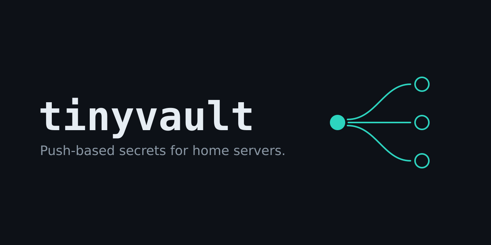

# tinyvault

[](https://github.com/CarsonZuniga/tinyvault/actions/workflows/ci.yml)
[](go.mod)
[](LICENSE)



I got tired of copying `.env` files around my home servers by hand, so I wrote this. It keeps secrets in one place and pushes them out over SSH when I tell it to. Nothing connects to the vault to fetch secrets, so it can sit on the LAN with no inbound access from the boxes it manages.

It's a single Go binary with a SQLite file. There's one admin login and no user accounts.

## Running it

```sh
go build ./cmd/tinyvault
./tinyvault genkey > master.key
./tinyvault hash-password > admin.hash

export TINYVAULT_MASTER_KEY_FILE=$PWD/master.key
export TINYVAULT_ADMIN_HASH_FILE=$PWD/admin.hash
export TINYVAULT_DB=$PWD/tinyvault.db
./tinyvault serve
```

Then go to http://localhost:8080.

To also require a code from an authenticator app at login, run `./tinyvault gentotp > totp.secret`, add the printed `otpauth://` link to the app, and set `TINYVAULT_TOTP_SECRET_FILE=$PWD/totp.secret`.

The master key encrypts everything in the database. Lose it and the data is gone, so back it up somewhere other than next to the db. To rotate it, stop the server, run `./tinyvault rotate-key > new.key` with the current key set, then point `TINYVAULT_MASTER_KEY_FILE` at `new.key` and restart.

To back up the database, run `./tinyvault backup /path/to/backup.db`. It's safe while the server is running, needs only `TINYVAULT_DB`, and won't overwrite an existing file, so put a date in the name when running it from cron. The backup is still encrypted, so it can go anywhere, but keep it apart from the master key.

### Docker

The provided `docker-compose.yml` runs the server, exposes port 8080 and stores data in `./data`. You must provide the environment variables listed under [Configuration](#configuration).

Or run it directly. Mount the two files and a volume for `/data`:

```sh
docker build -t tinyvault .
docker run -d -p 8080:8080 -v tinyvault-data:/data \
  -v $PWD/master.key:/run/secrets/master.key:ro \
  -v $PWD/admin.hash:/run/secrets/admin.hash:ro \
  -e TINYVAULT_MASTER_KEY_FILE=/run/secrets/master.key \
  -e TINYVAULT_ADMIN_HASH_FILE=/run/secrets/admin.hash \
  -e TINYVAULT_SECURE_COOKIES=true \
  tinyvault
```

## Configuration

| Variable | Purpose |
| --- | --- |
| `TINYVAULT_MASTER_KEY` | Base64 master key (generate with `tinyvault genkey`) |
| `TINYVAULT_ADMIN_HASH` | Argon2id hash of the admin password (generate with `tinyvault hash-password`) |
| `TINYVAULT_TOTP_SECRET` | Optional base32 TOTP secret; when set, login also asks for a code (generate with `tinyvault gentotp`) |
| `TINYVAULT_LISTEN` | Listen address (default `:8080`) |
| `TINYVAULT_SECURE_COOKIES` | Turn on once it's behind HTTPS |
| `TINYVAULT_IP_HEADER` | Set to `CF-Connecting-IP` (or similar) behind a proxy so login rate limiting sees real client IPs |
| `TINYVAULT_DB` | Path to the SQLite file |
| `TINYVAULT_AUDIT_RETENTION_DAYS` | Delete audit entries older than this many days (default: keep forever) |
| `TINYVAULT_HISTORY_KEEP` | Keep at most this many versions per key, always including the latest (default: keep all) |

The key, hash and TOTP secret can also be supplied as files via `TINYVAULT_MASTER_KEY_FILE`, `TINYVAULT_ADMIN_HASH_FILE` and `TINYVAULT_TOTP_SECRET_FILE`. If both forms are set, the `_FILE` version wins.

## Using it

Secrets are grouped by project and environment, e.g. `media/prod`. You can paste in an existing `.env`, JSON object or Kubernetes Secret to get started, and export back out in any of those formats or as shell `export` lines. Values can reference each other with `${OTHER_KEY}`, and that gets expanded on export if you ask for it.

Values stay hidden in the UI until you click Reveal. Every change keeps the old version around (up to `TINYVAULT_HISTORY_KEEP` versions, if set), so a bad edit or delete can be undone from the key's history page. Reveals, exports and pushes all show up in the audit log.

## Pushing

Each environment can have push targets. A target is a file on a host, like `/srv/media/.env` on `nas`. Hosts are shared, so one box can take targets from any number of projects, each with its own path and format.

1. Add the host on the Hosts page and copy the vault's SSH public key into `~/.ssh/authorized_keys` for that user on the host
2. On the environment page, add a target on that host, pick a format, and optionally give it a command to run afterwards, like `docker compose -f /srv/media/compose.yml up -d`
3. Hit Push

The file gets replaced in one step with `0600` permissions, so a failed push leaves the old one alone. The host key is saved the first time it connects. If it changes later, pushes to that host stop until you click "Forget host key" on the Hosts page. Do that only if you know the host was rebuilt.

Check tells you whether the file on the host still matches the vault, or whether someone edited it there since the last push.

`tinyvault check [project [env]]` runs the same check from the command line, using the same `TINYVAULT_MASTER_KEY` and `TINYVAULT_DB` as the server. It exits 1 if any target is not in sync and 2 if a check fails, so cron can alert on it:

```sh
0 * * * * . /etc/tinyvault.env && tinyvault check > /dev/null || curl -d "tinyvault targets need attention" https://ntfy.sh/my-topic
```
